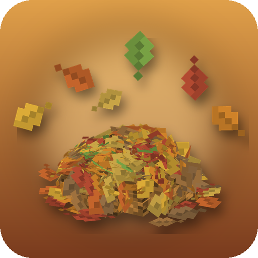
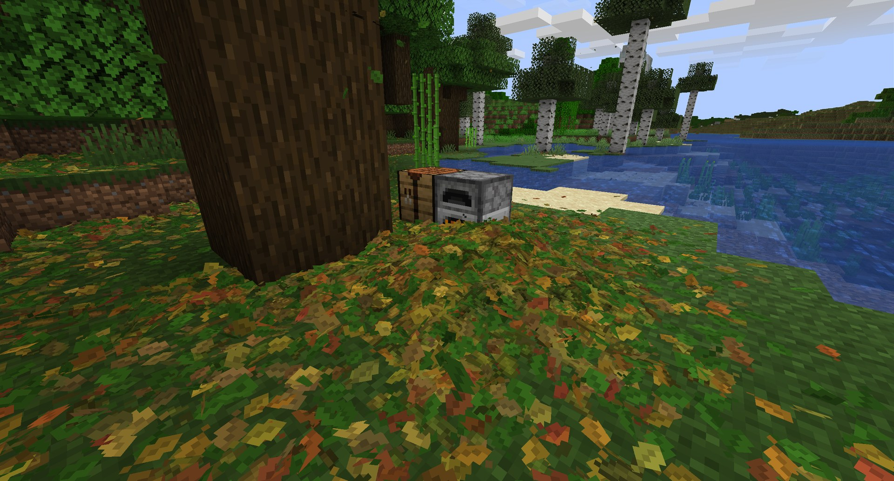

<p align="center">
  
</p>

<h1 align="center">Rustling Leaves</h1>

<p align="center">
  <b>Physically simulated leaves</b> - falling leaves, a forest floor you can wade through, rake into piles, gusts and whirlwinds.
</p>

<p align="center">
  <a href="https://www.curseforge.com/minecraft/mc-mods/rustling-leaves"></a>
  <a href="https://www.minecraft.net"></a>
  <a href="https://neoforged.net"></a>
  <a href="LICENSE"></a>
</p>

<p align="center">
  
</p>

## Features

- 🍂 **Falling leaves** - they let go of the crowns and come down like real leaves: fluttering, gliding in pendulum
  swings or tumbling; every tree sheds its own way, cherries drop petals. They wear the falling leaf textures of the
  newest Minecraft versions (the mod's classic leaf shapes are one config switch away) and cast crisp pixel shadows
  that follow the sun.
- 🌳 **A real forest floor** - patchy litter, drifts against trunks and walls, leaf piles that slump to a natural slope,
  fill hollows and rot away slowly; saved with the world.
- 👣 **Wade through piles** - steps push leaves aside and leave a trail, a jump into a pile splashes it up, mobs and
  arrows stir the leaves; sneaking leaves a carpet untouched.
- 🌬️ **Wind you can see** - gust waves skitter leaves over the ground, squalls strip trees, leaf whirlwinds wander over
  open ground; wind charges and explosions blow rings of leaves away.
- 🌊 **Leaves on water** - they soak and darken, drift with the current and down waterfalls, gather into rafts and sink.
- 🧹 **Rake them into piles** with a hoe or shovel while sneaking - your friends see the pile form too.
- 🖥️ **Client-side** - adds no items or blocks, so it works on any server, with or without the mod. On the server
  it is optional and only passes on where players rake.
- 🎨 **Colours of the tree** in every biome, modded trees included, with a share of autumn yellows and reds.
- ⚡ **Built for huge numbers** - cached GPU meshes and a simplified far layer keep thousands of leaves cheap out to the
  render distance.

## Controls

No keys. Just play:

| Action | Effect on leaves |
|---|---|
| Walk / sprint through leaves | Pushes them aside and leaves a trench; a few fly up |
| Sneak | Walk over a thin carpet without disturbing it |
| Jump into a pile | Leaves splash up around you |
| Sneak + hold right click with a hoe or shovel | Rake the leaves around that spot into a pile |
| Throw a wind charge | Blows leaves away in a swirl |
| Explode TNT | Clears the ground and throws leaves high into the air |
| Break a leaves block | Releases a burst of leaves |

## Configuration

`/rustlingleaves fallrate <value>` (client command, works on any server) sets `leaves.fallRate` in game, e.g. `3` for a
thick leaf fall; without a value it shows the current one.

`config/rustling_leaves-client.toml` (also in the in-game config screen: Mods -> Rustling Leaves -> Config):

| Option | Default | Description |
|---|---|---|
| `leaves.maxLeaves` | `8000` | Maximum number of moving leaves (0 disables the mod); lying leaves are not counted |
| `leaves.fallRate` | `1.0` | How often leaves fall from trees (0 = no falling leaves) |
| `leaves.treeFallRates` | `true` | Birches shed more, conifers less (off = all trees alike) |
| `leaves.spawnRadius` | `32` | Radius around you in which trees drop leaves |
| `leaves.carpetDepth` | `4` | Natural leaf carpet thickness (leaves per quarter block, 0 = none) |
| `leaves.naturalPiles` | `true` | Drifts against walls and trunks and occasional piles in forests |
| `leaves.litterLifetime` | `10.0` | In-game days until a carpet of fallen leaves has rotted away (piles last longer, 0 = never) |
| `leaves.litterDistance` | `128` | How far lying leaves are shown (capped by the render distance) |
| `leaves.leafSize` | `1.0` | Size of the leaves |
| `leaves.shadows` | `true` | Pixel shadows under falling leaves, inside piles and around their foot |
| `leaves.oldLeafTextures` | `false` | Draw leaves with the mod's original textures (leaf shapes, needles, petals) instead of the falling leaves of newer Minecraft versions |
| `leaves.autumnColors` | `0.35` | Share of leaves in autumn colors |
| `leaves.immersiveWeatheringPiles` | `true` | Draw Immersive Weathering's leaf piles as leaf litter |
| `leaves.realisticWaves` | `true` | With Realistic Waves: floating leaves ride its waves (off = flat vanilla water level) |
| `leaves.livingWind` | `true` | With Living Wind: leaves blow with its wind (off = their own wind) |
| `leaves.fallingLeavesMod` | `false` | With Falling Leaves or Living Wind: keep their falling leaves as well (off = only Rustling Leaves' leaves fall) |
| `leaves.leavesPerBreak` | `14` | Leaves released by a broken or decayed leaves block |
| `physics.windStrength` | `1.0` | Wind strength (0 = still air) |
| `physics.windEvents` | `1.0` | How often squalls and whirlwinds happen (0 = never) |
| `physics.entityStrength` | `1.0` | How strongly players, mobs and projectiles push leaves |
| `physics.explosionStrength` | `1.0` | How strongly explosions and wind charges blow leaves |
| `physics.raking` | `true` | Rake leaves with a hoe or shovel while sneaking |
| `seasons.enabled` | `true` | With Serene Seasons: leaves fall in autumn, the litter rots before winter |
| `seasons.autumnFallRate` | `3.0` | Fall rate multiplier at the autumn peak (mid and late autumn; less in early autumn) |
| `seasons.winterFallRate` | `0.0` | Fall rate multiplier in mid and late winter (0 = no leaves fall) |
| `seasons.springSummerFallRate` | `0.02` | Fall rate multiplier in spring and summer (cherry blossom petals not affected) |
| `seasons.autumnColors` | `3.0` | Multiplier of `leaves.autumnColors` in late autumn (capped at all leaves) |
| `seasons.seasonalDecay` | `1.0` | Extra rot of the litter in late autumn and winter, in carpets per sub-season (0 = none) |
| `sound.rustleVolume` | `0.6` | Volume of rustling |

Leaf litter is saved in `saves/<world>/rustling_leaves/` (singleplayer) or `rustling_leaves/servers/<address>/`
(multiplayer).

## Compatibility

[](https://www.curseforge.com/minecraft/shaders/pocky-shaders) ✅ **[Pocky Shaders](https://www.curseforge.com/minecraft/shaders/pocky-shaders)** (shader pack) - a shader pack that sways grass and tree crowns with the same gust waves that blow the leaves.

[](https://modrinth.com/mod/iris) ✅ **[Iris](https://modrinth.com/mod/iris)** (shader packs) - leaves and litter are lit and shaded like the blocks around them.

[](https://www.curseforge.com/minecraft/mc-mods/oculus) ✅ **[Oculus](https://www.curseforge.com/minecraft/mc-mods/oculus)** (shader packs on Forge) - the same as with Iris.

[](https://modrinth.com/mod/sodium) ✅ **[Sodium](https://modrinth.com/mod/sodium)** - works.

[](https://www.curseforge.com/minecraft/mc-mods/serene-seasons) ✅ **[Serene Seasons](https://www.curseforge.com/minecraft/mc-mods/serene-seasons)** (optional) - leaf fall is an autumn event: more and more red and yellow leaves, bare ground again early in winter.

[](https://modrinth.com/mod/immersive-weather-renewed) ✅ **[Immersive Weathering: Renewed](https://modrinth.com/mod/immersive-weather-renewed)** (optional) - its leaf piles are drawn as soft Rustling Leaves litter that merges with the forest floor.

[](https://www.curseforge.com/minecraft/mc-mods/realistic-waves) ✅ **[Realistic Waves](https://www.curseforge.com/minecraft/mc-mods/realistic-waves)** (optional) - leaves floating on the sea ride its swell and surf, rising, sinking and tilting with every wave.

[](https://www.curseforge.com/minecraft/mc-mods/falling-leaves-forge) ✅ **[Falling Leaves](https://www.curseforge.com/minecraft/mc-mods/falling-leaves-forge)** - Rustling Leaves takes over its falling leaves, so trees do not shed twice (its snow from snowy leaves stays; a config option keeps both).

[](https://www.curseforge.com/minecraft/mc-mods/living-wind) ✅ **[Living Wind](https://www.curseforge.com/minecraft/mc-mods/living-wind)** (optional) - leaves blow with its wind: the way its wind vanes point and as hard as it blows, calm on a clear day, wild in a storm. Rustling Leaves takes over the leaves it blows out of the crowns (its grass and dust stay).

## Installation

1. Install [NeoForge](https://neoforged.net) 21.1.144 or newer for Minecraft 1.21.1.
2. Put this mod into the `mods` folder of your client. The server does not need it; installed there as well, it
   shows every player's raking at the exact spot to the players nearby.

## Building

```sh
./gradlew build
```

The jar is written to `build/libs/`.

## Credits

- Author: **Pocky**.
- Falling leaf and petal textures: from newer Minecraft versions, adapted for tinting. Pile textures and logo:
  original, made for this mod. Sounds: vanilla Minecraft.

<!-- more-mods:start -->
## More mods by Pocky

**🌦️ Weather & nature**

<table>
  <tr>
    <td width="56"><a href="https://www.curseforge.com/minecraft/mc-mods/hoarfrost-snow-blizzards"></a></td>
    <td><a href="https://www.curseforge.com/minecraft/mc-mods/hoarfrost-snow-blizzards"><b>Hoarfrost: Snow & Blizzards</b></a> - seven kinds of snowfall, a living wind and soft snow on the land (<a href="https://github.com/Pocky-l/hoarfrost">source</a>)</td>
  </tr>
  <tr>
    <td width="56"><a href="https://www.curseforge.com/minecraft/mc-mods/petrichor-rain-storms"></a></td>
    <td><a href="https://www.curseforge.com/minecraft/mc-mods/petrichor-rain-storms"><b>Petrichor: Rain & Storms</b></a> - realistic rain, puddles, drips and branching lightning (<a href="https://github.com/Pocky-l/petrichor">source</a>)</td>
  </tr>
</table>

**💡 Light**

<table>
  <tr>
    <td width="56"><a href="https://www.curseforge.com/minecraft/mc-mods/lumen-rigs"></a></td>
    <td><a href="https://www.curseforge.com/minecraft/mc-mods/lumen-rigs"><b>Lumen Rigs</b></a> - aimable spotlights and floodlights with colored light and visible beams (<a href="https://github.com/Pocky-l/lumen-rigs">source</a>)</td>
  </tr>
  <tr>
    <td width="56"><a href="https://www.curseforge.com/minecraft/mc-mods/neon-glowsticks"></a></td>
    <td><a href="https://www.curseforge.com/minecraft/mc-mods/neon-glowsticks"><b>Neon Glowsticks</b></a> - throwable glowsticks that bounce, roll and light up the dark (<a href="https://github.com/Pocky-l/neon-glowsticks">source</a>)</td>
  </tr>
</table>

**🎨 Graphics & performance**

<table>
  <tr>
    <td width="56"><a href="https://www.curseforge.com/minecraft/mc-mods/turbo-for-distant-horizons"></a></td>
    <td><a href="https://www.curseforge.com/minecraft/mc-mods/turbo-for-distant-horizons"><b>Turbo for Distant Horizons</b></a> - Distant Horizons terrain generated several times faster (<a href="https://github.com/Pocky-l/dhturbo">source</a>)</td>
  </tr>
  <tr>
    <td width="56"><a href="https://www.curseforge.com/minecraft/shaders/pocky-shaders"></a></td>
    <td><a href="https://www.curseforge.com/minecraft/shaders/pocky-shaders"><b>Pocky Shaders</b></a> - a cosy, natural shader pack that shows the weather of these mods (<a href="https://github.com/Pocky-l/pocky-shaders">source</a>)</td>
  </tr>
</table>

**⚔️ Gear & gameplay**

<table>
  <tr>
    <td width="56"><a href="https://www.curseforge.com/minecraft/mc-mods/holy-staff"></a></td>
    <td><a href="https://www.curseforge.com/minecraft/mc-mods/holy-staff"><b>Holy Staff</b></a> - a healing staff with three skills and flying heal numbers (<a href="https://github.com/Pocky-l/holy-staff">source</a>)</td>
  </tr>
  <tr>
    <td width="56"><a href="https://www.curseforge.com/minecraft/mc-mods/ranchers-vacpack"></a></td>
    <td><a href="https://www.curseforge.com/minecraft/mc-mods/ranchers-vacpack"><b>Rancher's Vacpack</b></a> - a Slime Rancher vacuum gun for items and small mobs (<a href="https://github.com/Pocky-l/ranchers-vacpack">source</a>)</td>
  </tr>
</table>

**🔮 Magic**

<table>
  <tr>
    <td width="56"><a href="https://www.curseforge.com/minecraft/mc-mods/hextale"></a></td>
    <td><a href="https://www.curseforge.com/minecraft/mc-mods/hextale"><b>HexTale</b></a> - hextech magic to research, distil and bind with runes, inspired by Arcane and Thaumcraft (<a href="https://github.com/Pocky-l/HexTale">source</a>)</td>
  </tr>
</table>

**⚡ Tech & energy**

<table>
  <tr>
    <td width="56"><a href="https://www.curseforge.com/minecraft/mc-mods/mekanism-advancedgenerators"></a></td>
    <td><a href="https://www.curseforge.com/minecraft/mc-mods/mekanism-advancedgenerators"><b>Mekanism Advanced Generators</b></a> - nine tiers of solar panels, big solar generators, cubes and cables for Mekanism (<a href="https://github.com/Pocky-l/Mekanism-MoreSolarPanels">source</a>)</td>
  </tr>
</table>

**🛠️ Server tools**

<table>
  <tr>
    <td width="56"><a href="https://www.curseforge.com/minecraft/mc-mods/inventory-backups"></a></td>
    <td><a href="https://www.curseforge.com/minecraft/mc-mods/inventory-backups"><b>Inventory Backups</b></a> - inventory and ender chest backups with one-click restore for admins (<a href="https://github.com/Pocky-l/inventory-backups">source</a>)</td>
  </tr>
</table>

<!-- more-mods:end -->

## License

[MIT](LICENSE)
